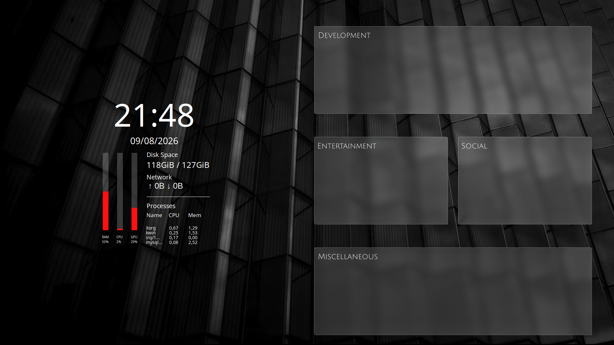

# Conky Widget

A minimalistic stylized widget, created for personal use.  Also, an opportunity to look into Lua.

Feel free to use it though, if it suits your needs.

## Details

The background image was made on Figma. It was created for a monitor of size 1920x1080, and adapted to fit LXQt desktop entries, so apps fit into organizational separations. The wallpaper photo is by [Samuel Scazo](https://unsplash.com/@scalzodesign), on [Unsplash](https://unsplash.com/photos/a-black-and-white-photo-of-a-building-xyuYk9oLA8I).

## How to Run

To make sure all imports work correctly, copy the repository as is to `~/.config/conky`. It should be named `ModernBasicsConky`.

You will need to have [Conky](https://github.com/brndnmtthws/conky) installed. Then, you can run `conky -c ./.conkyrc` in the repository folder to see it in action.

If you would like to have the widget available on startup instead, create a desktop entry and add it to the autostart folder of your desktop environment. You can create such file as specified [here](https://wiki.archlinux.org/title/Conky), and as given by the [inspired .desktop file in this repo](./startup.desktop). 

In case you wish to position it differently, make sure to change the `.conkyrc` file accordingly. You can alter the `alignment`, `gap_x` and `gap_y` properties to help placing it where it is most proper.